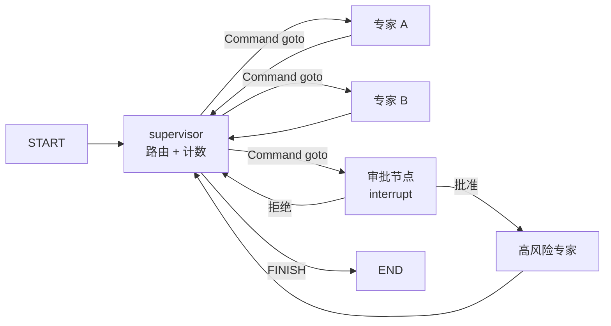

# 架构说明

## 组件关系



外部依赖只有两层：

- **LangGraph**：状态图、`Command` 路由、检查点、`interrupt`
- **LangChain**：`ChatOpenAI`、`create_agent`、`@tool`

## 状态契约

`TeamState` 继承 `MessagesState`：

| 字段 | 语义 | 谁写 |
| --- | --- | --- |
| `messages` | `add_messages` reducer，业务消息 + 路由记录 | supervisor / 专家 / 审批节点 |
| `task` | 当前任务原文，覆盖语义 | 入口 |
| `turn` | supervisor 已调度次数，覆盖语义 | supervisor |
| `stop_reason` | `finish` / `max_turns` / `error` / `awaiting_approval` | supervisor |

专家只接收 `name != "supervisor"` 的消息，路由话术不会污染专家上下文。

## 路由

1. supervisor 用 `with_structured_output` 让模型返回 `{next_agent, reason}`
2. 候选值由注册表动态生成 `Literal[...]`，模型给不出合法值就过不了校验
3. 中转不支持 `response_format` 时（如 deepseek），自动退化为“要求输出 JSON 再解析”
4. 非法目标或解析失败 → 终止并写明原因，不会静默当成正常完成

## 检查点与恢复

- 默认 `SqliteSaver`，`.multi_agent/checkpoints.sqlite`，按 `thread_id` 隔离
- 每个线程独立连接（WAL），支持并发任务各写各的
- `interrupt()` 挂起后状态落盘；`Command(resume=...)` 可从另一个进程继续
- 读取挂起载荷：`pending_approval(app, thread_id)`

## 审批流

```text
supervisor -> approve_publisher (interrupt)
              |-- approved: true  -> publisher -> supervisor
              '-- approved: false -> supervisor（带拒绝原因）
```

每次决策写一行 JSONL 审计（`MULTI_AGENT_AUDIT_LOG`），字段：时间、thread、专家、是否批准、备注、任务摘要。

## 上下文预算

`_trim_for_model()` 按 `MULTI_AGENT_CONTEXT_TOKENS` 裁剪：

- 用模型自己的 token 计数；不支持时退回字符估算
- `strategy="last"`，保留最近消息与首条任务
- 只影响发给模型的上下文，检查点内容不删

## 并发模型

- 图内：supervisor **串行**调度，一次一个专家
- 图外：`run_parallel(tasks)` 用线程池跑多个**独立任务**（多 SKU / 多站点），每个任务独立 thread 与 SQLite 连接
- HTTP：`TaskManager` 用线程池（`--max-workers`）跑提交上来的任务，每个任务 `build_graph()` 一次，
  保存的 app 用于审批恢复；任务表在进程内，重启即丢

## 入口层（HTTP API）

`multi_agent/api/` 只做包装，不碰图：

    POST /tasks ──> TaskManager.submit ──> 线程池 ──> LangGraphExecutor.start
                                                └──> run_task_full(app=..., thread_id=...)
                                                          │
                                     RunResult.pending ───┤ status=awaiting_approval（保存 app）
                                                          │
    POST /approvals/{id} ──> record_approval（审计）──> 线程池 ──> LangGraphExecutor.resume
                                                                  └──> resume_task(app=同一个 app)

关键点：API 不传 `approver` 回调，所以 `run_task_full` 遇到 `interrupt` 会**返回**而不是阻塞；
审批决策由 HTTP 请求异步触发，审计也在这里显式补写（`resume_task` 不会写审计）。

## 工具级审批

`AgentSpec.approval_tools` 指定的工具在构建时被包上 `_guarded_tool`：

    worker 执行 -> 工具返回 REQUIRES_APPROVAL::tool::args（未真正执行）
                -> worker 发现标记 -> 转 approve_<agent>
                -> 批准：approved_tools += tool -> 重跑 worker（工具真正执行）
                -> 拒绝：回 supervisor，附拒绝原因

上下文通过 `ContextVar` 传递，避免改专家状态结构；代价是首次尝试会多一轮模型调用。

## 已知限制

- 没有图内 `Send` 扇出，专家之间不能并行
- 回调只到节点级 `on_event`，没有 token 级流式
- 工具级审批会多一次专家调用（先探测、后执行）
- HTTP 任务表只在进程内，且只支持单进程 uvicorn；跨重启查询要另加任务数据库
